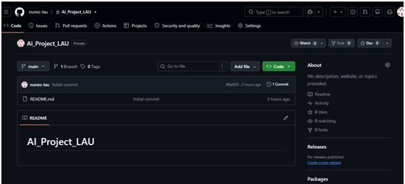
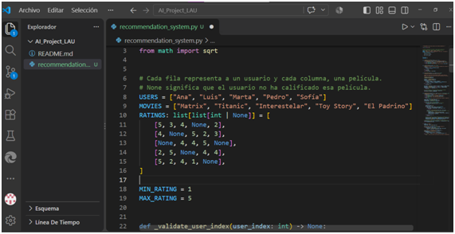
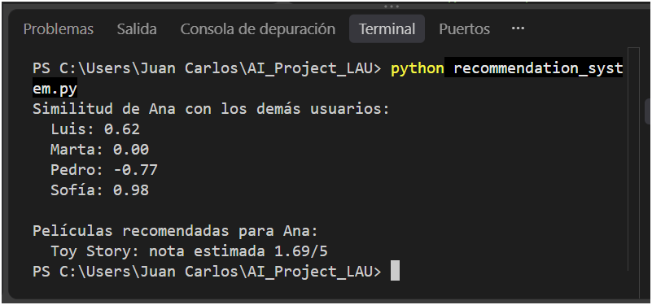

# Laboratorio: Exploración de Tendencias en Inteligencia Artificial  
**Fecha:** Octubre 2026  

---

## 1. Introducción y Objetivos
El objetivo de esta actividad práctica es explorar el uso de herramientas de asistencia al desarrollo basadas en Inteligencia Artificial Generativa. En este laboratorio se utilizó **GitHub Copilot** como copiloto técnico para comprender, refinar y documentar un sistema de recomendación basado en filtrado colaborativo y similitud coseno centrada.

---

## 2. Configuración del Entorno y Herramientas

### Paso 2.1: Cuenta de Estudiante y Acceso a GitHub Copilot
Se gestionó el acceso a la plataforma GitHub a través del programa de beneficios para estudiantes para activar las capacidades de IA en el entorno local.


### Paso 2.2: Creación del Repositorio Remoto
Se creó el repositorio en GitHub con el nombre `AI_Project_LAU`. Posteriormente, se utilizó la terminal integrada de Visual Studio Code para clonar el repositorio de forma local mediante el comando:
```bash
git clone https://github.com/nunez-lau/AI_Project_LAU.git
```


---

## 3. Desarrollo del Sistema de Recomendación

Se estructuró el archivo `recommendation_system.py` aplicando algoritmos avanzados de **Filtro Colaborativo Usuario-Usuario**. El código calcula la **Similitud Coseno Centrada (Correlación de Pearson)** para predecir qué películas le gustarán a un usuario basándose en los hábitos de la comunidad, mitigando los sesgos de calificación.

### Evidencia de la Asistencia de GitHub Copilot
Durante la escritura, GitHub Copilot asistió sugiriendo bloques de código lógico y optimizaciones de cálculo vectorial para las desviaciones de notas.




## 4. Ejecución y Resultados del Script

Para validar el funcionamiento del sistema, se ejecutó el módulo de pruebas analizando el perfil del usuario **Ana**. El script calculó con éxito su afinidad matemática con el resto de los usuarios (Luis, Marta, Pedro y Sofía) y generó la recomendación correspondiente para la película *Toy Story*.

### Comando de ejecución utilizado en la terminal:
```bash
python recommendation_system.py
```



## 5. Conclusiones
La incorporación de herramientas como GitHub Copilot agiliza el flujo de trabajo del desarrollador. No solo automatiza tareas repetitivas o código boilerplate, sino que actúa como un tutor interactivo que ayuda a estructurar de manera óptima algoritmos matemáticos complejos, elevando la calidad técnica del software producido.